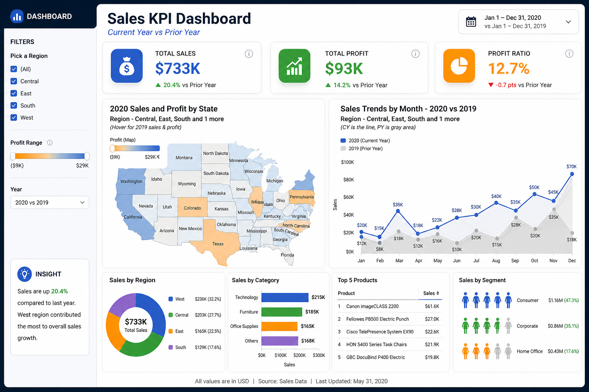
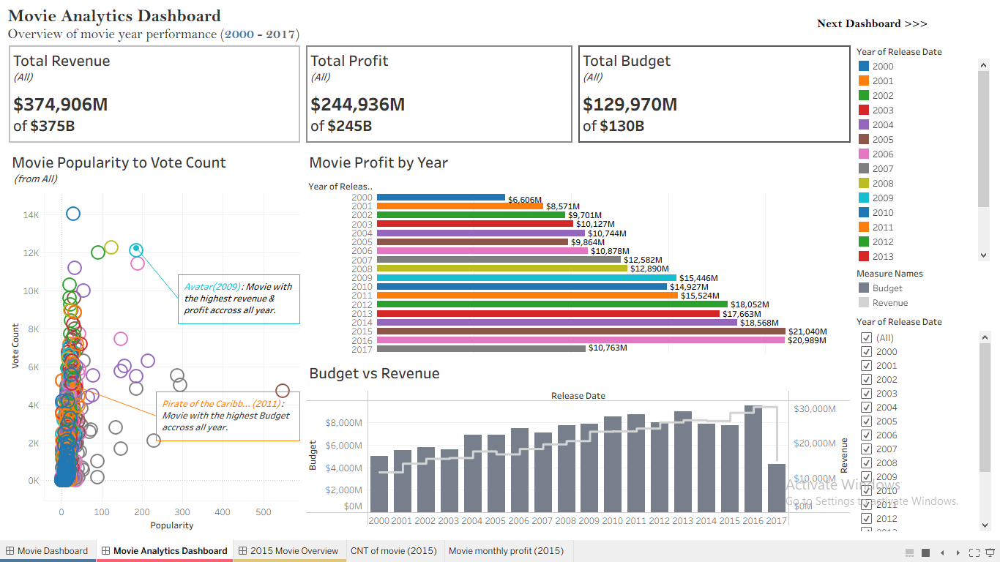
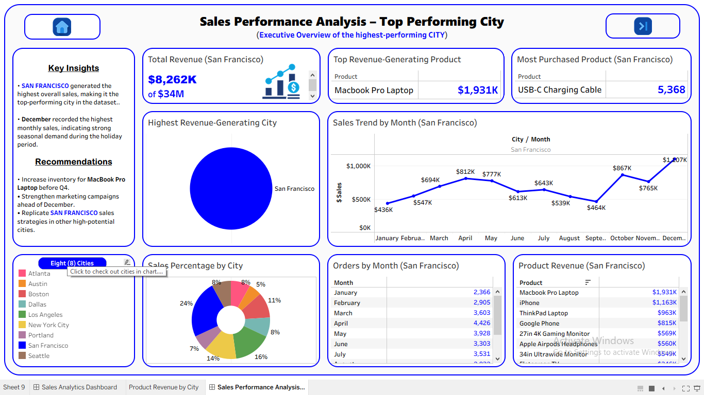

<h1 align="center">Hi, I'm Opeyemi👋</h1>

<h3 align="center">Data & Business Intelligence Analyst</h3>

  I enjoy working with data, finding the story behind the numbers, and turning analysis into insights that help people make better decisions.

  
  
  
  

---

## About Me

I'm a Data & Business Intelligence Analyst with an interest in using data to understand business performance, uncover patterns, and answer meaningful questions.

I work with tools such as SQL, Python, Excel, and Tableau to explore datasets, clean and analyze information, and build visual reports that make findings easier to understand.

I enjoy the process of taking raw data, asking the right questions, and turning the results into something useful. My projects cover different areas, including business performance, customer experience, e-commerce, job market trends, and data quality.

I'm always learning, improving my approach, and looking for opportunities to work on problems where data can make a real difference.

**A little more about what I do:**
- Explore and analyse datasets to identify trends, patterns, and opportunities.
- Use SQL and Python for data cleaning, transformation, and analysis.
- Build dashboards and reports that communicate findings clearly.
- Translate analytical results into practical business insights.
- Keep developing my technical and problem-solving skills through hands-on projects.

---

## Featured Projects

Here are five projects that reflect the kind of analysis I enjoy doing.

### 1. Sunrise Coffee Chain Performance Analysis
**Tools:** Tableau, Data Analysis, Business Intelligence

An analysis of Sunrise Coffee Chain's performance, focusing on revenue, profitability, transactions, product categories, customer loyalty, and business trends. The project turns business data into an interactive dashboard and practical insights.

[View Project Repository](https://github.com/Cephasia/Sunrise-Coffee-Performance-Analysis)

### 2. Nigeria Commercial Banking Experience Analysis
**Tools:** SQL, Data Analysis

An exploration of commercial banking experiences in Nigeria, using data to examine customer experiences and identify patterns that can support a better understanding of the banking sector.

[View Project Repository](https://github.com/Cephasia/Nigeria-Commercial-Banking-Experience-Analysis)

### 3. Olist E-commerce SQL Analysis
**Tools:** SQL, Data Analysis

A SQL-based analysis of e-commerce data, exploring business performance and customer-related patterns to uncover useful insights from the dataset.

[View Project Repository](https://github.com/Cephasia/Olist-Ecommerce-SQL-Analysis)

### 4. NCAA Flight Data Audit
**Tools:** Data Analysis, Data Quality

An investigation focused on examining flight data, identifying inconsistencies, and understanding issues that can affect the reliability of data used for analysis.

[View Project Repository](https://github.com/Cephasia/When-the-Numbers-Don-t-Add-Up)

### 5. Data Job Postings Analysis
**Tools:** Data Analysis, Data Visualization

An exploration of data-related job postings to understand the roles, skills, and opportunities appearing across the data job market.

[View Project Repository](https://github.com/Cephasia/Data-Job-Posting-Analysis)

---

## Dashboard Gallery

A selection of dashboards and visual reports I've worked on.

### Sunrise Coffee Chain Performance

  

  

  

  

### Other Dashboards

  

  

  

---

## Tools & Skills

| Skill | Proficiency |
|---|---|
| SQL | Intermediate |
| Excel | Advanced |
| Tableau | Advanced |
| Python | Advanced |
| pandas | Advanced |
| matplotlib | Advanced |

---

## Let's Connect

I'm always open to connecting with fellow analysts, learning from others, sharing ideas, and exploring opportunities to contribute to meaningful data projects.

  <a href="https://github.com/Cephasia">GitHub</a> •
  <a href="https://www.linkedin.com/in/opeyemi-peter-394b333a1">LinkedIn</a> •
  <a href="https://x.com/cephasia001">X</a> •
  <a href="https://www.instagram.com/cepha_sia">Instagram</a> •
  <a href="mailto:ismailopeyemi3310@gmail.com">Email</a>

  <b>Opeyemi (Ismail) Peter</b> 
  Data & Business Intelligence Analyst

  <i>© 2026 Opeyemi (Ismail) Peter. Built with purpose.</i>

